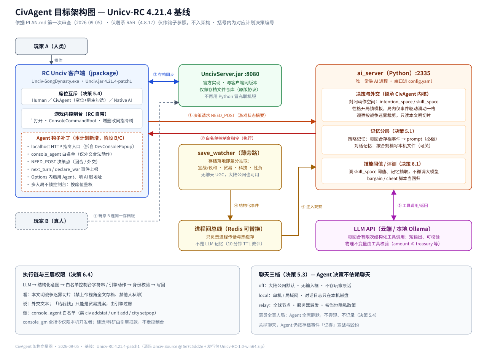

# CivAgent · Song Dynasty

一个跑在开源策略游戏 [Unciv](https://github.com/yairm210/Unciv) 里的 **LLM 外交智能体**：
游戏里的领袖可以和你自由对话、谈交易、结盟、宣战和议和；棋盘上的微操仍然交给原生 AI。
本仓库是这一支的整合版本——大脑、本地模型接入、训练场评测与游戏侧接入文档放在一起。

> **English TL;DR** — An LLM diplomatic agent for Unciv with local-model support
> (Ollama / vLLM / LM Studio / llama.cpp / LMDeploy), an optional CPU decision gate (jevos),
> and a headless arena for evaluation. Windows build lives in Releases.

<p align="center">
  
</p>

> **状态 v0.3alpha** — 仍然未取得很好的效果，正在思考未来的方向。

## 目录

| 路径 | 内容 |
|------|------|
| `deployment/ai/agent_api.py` | 大脑 HTTP 服务（默认 `127.0.0.1:2335`）：决策、对话、记忆、信任 |
| `civagent/utils/` | 模型路由、本地服务探测、jevos 决策闸门、信任/记忆、意图模型 |
| `civagent/mcp_server.py` | 把受白名单约束的控制台能力暴露给 MCP 客户端 |
| `arena/` | 无头训练场：轮换对局、国力/权重/出生分类、榜单与报告 |
| `docs/local_models.md` | 本地部署（各服务器端口、上下文探测、结构化输出降级、故障对照） |
| `docs/` | 开发、复现、协议与模组兼容文档 |
| `scripts/` | 启动脚本与数据导出 |
| `tests/` | pytest（210+ 例，多数不联网） |

## 快速开始（Windows）

1. **下载游戏**：Releases 里的 `Unciv-SongDynasty-v0.3alpha-win64.zip`，解压到任意目录
   （解压后运行 `Unciv-SongDynasty.exe`）。对应游戏源码在同一 Release 的
   `Unciv-Source-v0.2.1-src.zip`（GPL 要求的对应源码）。APK 暂未提供。
2. **准备大脑**（需要 Python 3.12）：
   ```bash
   python -m venv .venv && .venv\Scripts\activate
   pip install -r requirements.txt
   python -m deployment.ai.agent_api          # 默认 127.0.0.1:2335
   ```
   或直接（探测 2335，未起则拉起，可选带游戏）：
   ```powershell
   pwsh -NoProfile -ExecutionPolicy Bypass -File scripts/start-host.ps1
   pwsh -NoProfile -ExecutionPolicy Bypass -File scripts/start-host.ps1 -LaunchGame
   ```
3. **配置模型**：游戏内 `Options → CivAgent` 选 Provider、填 Base URL 和 Model；
   也可以把密钥写进仓库根目录 `.env`（`DEEPSEEK_API_KEY` / `OPENAI_API_KEY` 等）后重启大脑。
4. **开新局**：新游戏高级设置里勾选 `Enable Faction Balance`（派系平衡）；
   在 Options → CivAgent 打开 `Enable CivAgent brain`，需要的话勾选 `Fill empty seats with CivAgent`。
5. **对话**：点世界界面顶栏的对话图标，选一个席位说话。意图会先成为草稿，
   在**该席位的下一回合**执行；针对你的动作会先弹确认框。

> 本版本全程本地运行：对话与决策只发往**你自己配置的模型服务**，不上传 Fuxi 的服务器。

## 本地模型

不用云端也能跑。大脑会自动发现本机的 OpenAI 兼容服务，并把探测结果写进
`GET /healthz` 与 `GET /status`：

```bash
export LLM_DEFAULT_PROVIDER=ollama          # 或 vllm / lmstudio / llamacpp / sglang / openai_compatible
export CIVAGENT_MODEL=qwen3:32b             # 模型 id；也可写 vllm/Qwen/Qwen2.5-32B-Instruct
```

支持 Ollama（`:11434`）、LM Studio（`:1234`）、vLLM（`:8000`）、SGLang（`:30000`）、
llama.cpp（`:8080`，新默认 `:9931`）、LMDeploy（`:23333`）。
上下文预算、结构化输出（JSON Schema → JSON → 纯文本降落）、推理段剥离、超时与故障排查见
[`docs/local_models.md`](docs/local_models.md)。

**可选：jevos 决策闸门**（CPU，MIT）。它不生成意图，只决定 LLM 提的动作这一轮值不值得做：

```bash
export CIVAGENT_JEV_GATE=1
export CIVAGENT_JEV_URL=http://127.0.0.1:8017   # jevos 默认端口
export CIVAGENT_JEV_THRESHOLD=0.5
```

服务没起、超时或返回异常时**原样放行**，不影响原有行为。

## 训练场

不需要游戏客户端也能跑对局与评测：

```bash
python arena/report.py --kind rotation --maps '测试arena.json'
python arena/nation_strength.py --write --md arena/ranking-total.md --maps '测试arena.json'
```

地图生成、轮换、权重拟合与榜单细节见 [`arena/README.md`](arena/README.md)。
对局数据（国力采样、终局存档）由游戏侧 `ArenaLauncher` 写入 `SaveFiles/`。

## 测试

```bash
python -m pytest tests/ -q
```

本地模型探测与 jevos 适配的测试走真实 loopback socket（临时端口假服务器），不下载模型、不访问外网。

## 已知限制

- 外交效果的评测还没有稳定结论；这是当前"效果不够好"的主要来源。
- 游戏侧决策超时是 15 秒硬编码（Options 里不可调），32B 级本地模型容易超时后静默回退原生 AI。
- APK 尚未提供；Windows 包为 x64 自包含运行时。
- jevos 的七项基准在 0.36–0.92 之间，外交多步推理不在其中；默认阈值 0.5 只是起点。

## 许可证

以 **GPL-3.0** 发布，见 [`LICENSE`](LICENSE)。代码源自
[fuxiAIlab/CivAgent](https://github.com/fuxiAIlab/CivAgent)（MPL-2.0）的部分仍可按 MPL-2.0 获取，
见 [`LICENSE-MPL-2.0`](LICENSE-MPL-2.0)。Windows 发布包对应的游戏源码见 Releases 的
`Unciv-Source-v0.2.1-src.zip`。

致谢：[Unciv](https://github.com/yairm210/Unciv)（游戏）、
[fuxiAIlab/CivAgent](https://github.com/fuxiAIlab/CivAgent)（原始 CivAgent）、
[feder-cr/jev](https://github.com/feder-cr/jev)（jevos 决策模型）。
